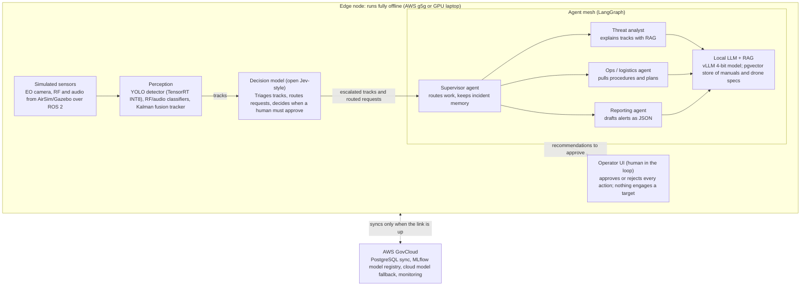

# Edge Base-Defense Copilot — Project Plan

Oct 9, 2026 · @Edgar

## Project summary

Build one edge node that detects and triages drones and helps outpost staff plan and report, fully offline, in 12 weeks, using only public and synthetic data.

The node fuses camera (EO), radio (RF) and audio sensors to track drones. A calibrated decision model triages each track. A team of LLM agents explains threats, pulls procedures and drafts reports, with a human approving every action. When the network returns, the node syncs to AWS GovCloud.

- **Timeline:** 12 weeks, solo, part-time.
- **Hardware:** no Jetson required. Use an AWS g5g instance or a GPU laptop; a Jetson is optional for final validation.
- **Target employers:** Booz Allen, GDIT, ManTech, CACI, SAIC, Leidos (agentic AI); Anduril, Lockheed Martin (Orlando, Fort Worth), Shield AI, L3Harris, Northrop Grumman (edge AI and counter-UAS).

## Problem statement

Forward units must spot and judge small drones and run their own planning and reporting while their network link is jammed, cut or slow, and today's AI mostly assumes a cloud connection.

Five gaps from the October 2026 research drive the project:

1. **Drone threats outpace defenses.** On Sept 29, 2026, JIATF-401 and the Army announced counter-UAS contracts with a $4.15B combined ceiling, expected to reach $7B. The task force director says demand has outpaced supply.
2. **AI fails when the network does (DDIL).** Army writing calls cloud reliance a tactical vulnerability. The Army awarded webAI $14.5M on Oct 8, 2026 for AI that keeps working under DDIL.
3. **Frontier models stop at the unclassified level.** GenAI.mil runs at IL5/CUI. Frontier models also refuse many legitimate military questions, per an EdgeRunner study.
4. **Operators are overloaded.** Every track and request needs a human look. The Pentagon's 2026 AI strategy funds agents (Agent Network, Enterprise Agents) to take routine work off staff.
5. **No one trusts unproven AI.** CDAO requires test and evaluation across model, human-system, integration and operational levels before fielding.

**Project goal:** show that one offline node can detect drones, triage them with honest confidence, and run agents that explain, plan and report, while keeping a human in charge and proving it all with measured results.

## What the system does

One edge node at a simulated outpost watches for drones and supports the staff, fully offline, and syncs with GovCloud when a link returns.

**Demo scenario:** the network link drops. A drone appears on camera and radio. The detector and tracker pick it up, the decision model flags it as a likely threat, and the threat analyst explains why using cited specs. The ops agent pulls the matching procedures, the reporting agent drafts an alert, and the operator approves it. When the link returns, data and logs sync to GovCloud.

Data flows top to bottom: sensors become tracks, the decision model filters them, agents explain and draft, and the operator approves. The node talks to GovCloud only when a link exists.

## Data sources

Everything comes from public or synthetic sources; nothing marked CUI or classified is ever used. Dataset names are from memory, so confirm each still exists and check its license before building on it.

| Need | Source | Used for |
| --- | --- | --- |
| Drone video and images (EO/IR) | Anti-UAV challenge sets, Drone-vs-Bird, MAV-VID, DUT Anti-UAV | Fine-tuning and testing the detector |
| Drone radio signals (RF) | DroneRF dataset; RadioML (DeepSig) for practice | Training the RF classifier |
| Drone audio | Public drone-audio sets on GitHub/Kaggle | Training the audio classifier |
| Synthetic scenes | AirSim or Gazebo renders with automatic labels | Filling data gaps; DDIL and stress tests |
| Documents for RAG | Army and Air Force manuals marked Distribution A, FAA drone guidance, manufacturer spec sheets | Agent knowledge base |
| Triage labels | Hand-labeled tracks from the sim (benign, unknown, likely threat) | Fine-tuning the decision model |

**Data rule:** use only documents marked "Distribution A: approved for public release." Skip Distribution B through F and anything marked CUI.

## Models

Start from pretrained models and fine-tune where the domain demands it; train from scratch only the small signal classifiers.

| Model | Starting point | What you do | Priority |
| --- | --- | --- | --- |
| Drone detector | COCO-pretrained YOLO (COCO has no "drone" class) | Fine-tune on real + synthetic drone data, then quantize to INT8 with TensorRT | Core |
| RF and audio classifiers | None | Train small CNNs from scratch | Cuttable |
| Decision model | Open Jev-style model (SemIf, Kev or Laya) | Fine-tune on your triage labels, then check calibration | Core |
| Agent LLM | Open-weight 7–8B (Llama, Qwen or Gemma class), 4-bit quantized | Use as-is; optional LoRA for report format and fewer refusals | Optional |
| Embeddings | Open embedding model + re-ranker | Use as-is; optional fine-tune on military terms | Optional |

Jev is TypeSafe AI's closed decision model, launched September 15, 2026; use an open alternative you can run and inspect locally. Fine-tune before you quantize, and measure accuracy after each step.

## Skills map

The project uses 31 skills, listed here in the order you build them; only autonomy and LoRA are partial.

| Week | Skill | Where it's used | How |
| --- | --- | --- | --- |
| 1 | Experiment tracking + data versioning | All training | MLflow logs every run; DVC versions the datasets |
| 1 | Docker | Every component | Containers built for x86 and ARM (Jetson-ready) |
| 1–2 | Synthetic data | Detector training and tests | AirSim/Gazebo render labeled drone scenes |
| 1–2 | ROS 2 | Sensor pipeline | Sensors, detector and tracker exchange messages |
| 2 | Computer vision | Drone detector | YOLO finds drones in camera video |
| 2 | Fine-tuning / transfer learning | Drone detector | COCO-pretrained YOLO fine-tuned on drone data |
| 2 | Ablation study | Drone detector | Pretrained vs real vs real + synthetic |
| 3 | Model compression + edge deployment | Drone detector | PyTorch → ONNX → TensorRT INT8 on the node |
| 3 | Signal ML (from scratch) | RF and audio | Small classifiers spot drone signatures |
| 3 | Sensor fusion | Tracker | Kalman filter merges EO, RF and audio into tracks |
| 4 | vLLM serving | Edge node | Serves the local LLM (Ollama on a laptop) |
| 4 | Open-weight LLM + quantization | All agents | 7–8B model at 4-bit, fully offline |
| 4–5 | RAG | Agent knowledge | Manuals and specs chunked, embedded, retrieved with citations |
| 4–5 | pgvector / PostgreSQL | Edge and cloud | Vector store on the node; sync target in GovCloud |
| 5 | Embeddings + re-ranking | Retrieval | Embeddings find passages; a re-ranker picks the best |
| 5–6 | Decision model | Triage and routing | Open Jev-style model makes fast typed calls with probabilities |
| 6 | Calibration | Decision model | ECE and reliability plots set escalation thresholds |
| 7 | LangGraph | Agent workflow | Graph of agents, tools and checkpoints |
| 7 | Multi-agent orchestration | Agent mesh | Supervisor routes to threat, ops and reporting agents |
| 7 | Tool calling | Agents | Query tracks, search docs, draft reports, request approval |
| 7 | Structured outputs | Reporting agent | Alerts and reports as Pydantic-validated JSON |
| 8 | Agent memory | Supervisor | Keeps incident history across steps |
| 8 | Human in the loop | Operator UI | LangGraph pauses for approve or reject |
| 8 | Prompt versioning | Agents | Prompts in git or Langfuse, evaluated like code |
| 9 | Observability | Every agent step | Langfuse/OpenTelemetry traces |
| 9 | CI eval gate | Models and prompts | Changes ship only if they beat current metrics |
| 10 | DDIL design + cloud fallback | Edge node | Works offline, queues data, routes hard questions to cloud when linked |
| 10 | AWS GovCloud | Cloud side | Sync database and model registry |
| 11 | Canary, rollback, drift monitoring, edge model sync | MLOps/LLMOps | Safe model swaps pushed to the node when linked |
| 11 | AI security | Agents | Prompt-injection tests against approval bypass |
| 12 | T&E reporting | Whole system | One-page report on CDAO's framework |

**Partial skills:**

- **Autonomy:** detection, tracking and triage run on their own, but nothing moves. Optional upgrade: a simulated pan-tilt camera that slews to follow the top track.
- **LoRA/PEFT:** only if you're ahead in week 11.

## Build order

Build bottom-up in five phases, and don't start a phase until the previous gate passes; the Skills map lists every skill by week.

| Phase | Weeks | 1 · 2 · 3 · 4 · 5 · 6 · 7 · 8 · 9 · 10 · 11 · 12 |
| --- | --- | --- |
| Perception + fine-tuning | 1–3 | ███ |
| LLM, RAG + decision model | 4–6 | ░░░ ███ |
| Agents + operator UI | 7–9 | ░░░ ░░░ ███ |
| DDIL, sync + MLOps | 10–11 | ░░░ ░░░ ░░░ ██ |
| Evals + write-up | 12 | ░░░ ░░░ ░░░ ░░ █ |

1. **Weeks 1–3, perception + fine-tuning:** set up MLflow, DVC and Docker; build the AirSim/Gazebo scene and ROS 2 pipeline; fine-tune YOLO on real + synthetic data; quantize to TensorRT INT8; train RF/audio classifiers; build the Kalman tracker.
   - **Gate:** tracks stream on the node with measured mAP and FPS.
2. **Weeks 4–6, LLM, RAG + decision model:** serve a 4-bit open model with vLLM; build the pgvector RAG store with re-ranking; fine-tune the open decision model on triage labels and calibrate it.
   - **Gate:** RAG answers cite sources and the decision model has a measured ECE.
3. **Weeks 7–9, agents + operator UI:** build the LangGraph supervisor and three agents with tools, memory and structured outputs; add human approval checkpoints, the operator UI, Langfuse tracing, prompt versioning and the CI eval gate.
   - **Gate:** the full demo scenario runs end to end offline.
4. **Weeks 10–11, DDIL, sync + MLOps:** add link-loss handling, store-and-forward sync to GovCloud, cloud fallback, canary and rollback, drift monitoring, edge model sync and prompt-injection tests. Optional: LLM LoRA or the pan-tilt autonomy upgrade if ahead.
   - **Gate:** no data loss across link drops; zero approval bypasses.
5. **Week 12, evals + write-up:** run 20+ scenarios, produce the T&E report, model cards, demo video and README.
   - **Gate:** all deliverables published.

## MLOps and LLMOps

Every model and prompt moves through one tracked, gated pipeline, from training to the edge node and back.

**MLOps** covers the trained models (detector, RF/audio classifiers, decision model). **LLMOps** covers the LLM system (serving, prompts, RAG index, evals, tracing).

1. **Track:** MLflow logs data version, settings and metrics for every run; DVC versions the datasets.
2. **Train:** one command runs data → fine-tune → quantize → evaluate → register.
3. **Register:** versioned models in an MLflow registry, tagged staging or production.
4. **Gate:** CI blocks any model or prompt change that doesn't beat current mAP, calibration and RAG faithfulness.
5. **Index:** changed documents are re-chunked, re-embedded and re-tested automatically.
6. **Deploy:** canary swap on the node, with automatic rollback if live metrics drop.
7. **Sync:** when the link is up, GovCloud pushes approved model versions to the node and pulls logs back.
8. **Monitor:** alerts when detector confidence or decision calibration drifts.

**Minimum if time runs short:** MLflow, the registry and the CI eval gate. The full ATO-style security pipeline (signed artifacts, SBOM, NIST control mapping) stays a separate follow-on project.

## Testing and evaluation

Each layer is tested on its own, then the whole system is tested under link loss and attack; pass bars compare against baselines rather than invented numbers.

| Level (CDAO framework) | Test | Metric | Pass bar |
| --- | --- | --- | --- |
| Model | Detector accuracy | mAP on held-out real data | Fine-tuned beats pretrained baseline |
| Model | Quantization cost | mAP and FPS, FP32 vs INT8 | Accuracy drop small enough to justify the speedup; report both |
| Model | Synthetic data value | mAP, real-only vs real + synthetic | Report the difference either way |
| Model | Decision calibration | ECE, reliability plot | Fine-tuned better calibrated than base |
| Model | RAG quality | Ragas/DeepEval faithfulness, citation accuracy | Every answer cites a retrieved passage |
| Integration | Agent routing | Right agent chosen, right tool calls | Measured on a fixed test set of requests |
| Integration | End-to-end latency | Time from detection to drafted alert | Report median and worst case |
| Integration | DDIL | Task quality at 0%, 50%, 100% link loss | No crash; offline quality reported |
| Integration | Sync | Data and models after reconnect | No lost or duplicated records |
| Security | Prompt injection | Poisoned document tries to skip approval | Zero bypasses |
| Human-system | Operator workload | Alerts per hour, with and without triage | Triage lowers alerts without missing threats |
| Human-system | False alarms | False alarms per hour | Reported per scenario |
| Operational | Scenario runs | 20+ simulated incidents end to end | Results in the T&E report |

All results go into a one-page T&E report organized by the four CDAO levels: model, human-system, integration and operational. Label every speed number by where it was measured (g5g, laptop or Jetson); power isn't measured without real hardware.

## Safety and security rules

The system supports human decisions and never acts on its own, and the project never touches non-public data.

- **Human in charge:** the node detects, triages and recommends. Every action needs operator approval, and nothing engages a target.
- **Public data only:** Distribution A documents, public datasets and synthetic data. No CUI, no work data, no classified material, and nothing from your Air Force job.
- **Honest confidence:** escalation thresholds come from measured calibration, not guesses.
- **Injection defense:** retrieved text is treated as data, never as instructions; agents can't change their own approval rules.
- **Audit trail:** every agent step is traced and logged.
- **Honest reporting:** state what was simulated, where each number was measured and what wasn't tested (real power, real RF environments).

## Scope cuts and risks

The biggest risk is not finishing, so the cut order is decided now and the core chain is protected.

**Core that must survive:** detector → decision triage → threat analyst with RAG → human approval → sync. That chain alone shows edge AI, RAG, multi-agent orchestration and calibrated decisions.

**Cut in this order if behind:**

1. LLM LoRA fine-tuning
2. RF and audio fusion (EO only is fine)
3. Cloud model fallback
4. Ops/logistics agent
5. Canary, drift monitoring and edge model sync (keep MLflow, registry and CI gate)

| Risk | Effect | Fallback |
| --- | --- | --- |
| Simulator setup eats weeks | Late detector | Train on public datasets first; add synthetic later |
| Open decision model underperforms | Poor triage | Fall back to a small classifier on track features; keep the calibration work |
| 7–8B model too slow on the node | Laggy agents | Drop to a 3–4B model or more aggressive quantization |
| g5g instance unavailable | No ARM + NVIDIA test | Use any NVIDIA GPU for TensorRT, plus Docker limits and ARM builds |
| Dataset license or availability changes | Missing data | Swap to another listed dataset or more synthetic data |

## Deliverables

The finished project is a public repo, a short demo video and a one-page T&E report that a hiring manager can review in ten minutes.

- [ ] **GitHub repo** with a README, architecture diagram and one-command setup
- [ ] **3–5 minute demo video:** link drops, a drone appears, triage escalates it, the agent pulls procedures, the operator approves, the link returns and data syncs
- [ ] **One-page T&E report** organized by the four CDAO levels
- [ ] **Model cards** for the detector and the decision model
- [ ] **Short write-up or blog post** on what worked, what didn't and what was simulated

**Presenting it:** use the exact tool names from postings (LangGraph, vLLM, pgvector, TensorRT, Langfuse, MLflow, AWS GovCloud). Lead with measured results, not features. For agentic AI roles, open with the agent mesh and evals; for edge and counter-UAS roles, open with the detector and DDIL tests.

## Glossary

| Term | Meaning |
| --- | --- |
| DDIL | Denied, Disrupted (or Degraded), Intermittent, Limited bandwidth: operating when the network is jammed, cut, unreliable or slow |
| EO / EO-IR | Electro-optical: visible-light cameras; IR adds infrared (thermal) cameras |
| RF | Radio frequency: the radio signals drones use for control and video |
| Counter-UAS | Detecting and defending against unmanned aircraft (drones) |
| RAG | Retrieval-augmented generation: the LLM answers from retrieved documents and cites them |
| Decision model | A model that answers typed questions (yes/no, choice, score) with probabilities instead of writing text; Jev is one |
| Calibration / ECE | Whether stated confidence matches real accuracy; Expected Calibration Error measures the gap |
| Quantization | Shrinking a model to lower-precision numbers (INT8, 4-bit) so it runs faster on small hardware |
| mAP | Mean average precision: the standard detector accuracy score |
| T&E | Test and evaluation |
| CDAO | The Pentagon's Chief Digital and Artificial Intelligence Office |
| CUI | Controlled Unclassified Information: never used in this project |
| IL5 | DoD cloud impact level for higher-sensitivity unclassified data |
| ATO | Authority to Operate: the approval a system needs before it runs on government networks |
| LoRA / PEFT | Low-cost fine-tuning that trains a small add-on instead of the whole model |
